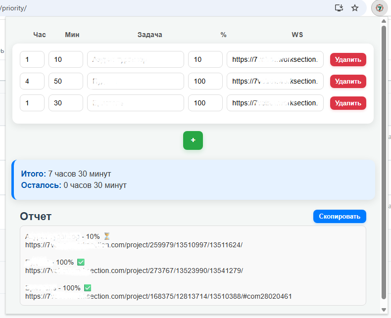

## Расширение для браузера
Позволяет автоматизировать составление ежеденевного отчета для работодателя

### Представляет собой табличную форму для ввода
* названия проекта
* ссылки на него в трекере задач
* процент выполнения
* потраченного времени

### Ведет подсчет
* суммарного затраченного времени
* остатка часов до полного рабочего дня

Отчет в текстовом виде удобно копируется одним кликом

Данные сохраняет в LocalStorage

Расширением успешно восользовались суммарно более 50 сотрудников компании на протяжении 2-х лет

